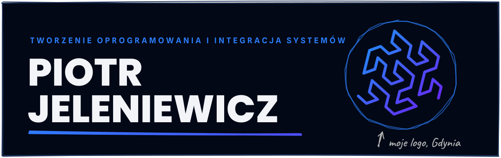
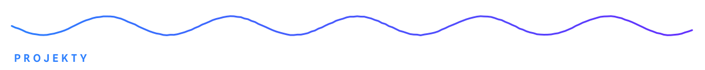
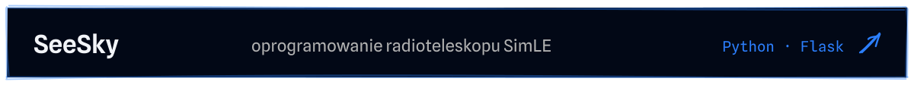
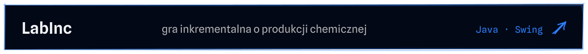
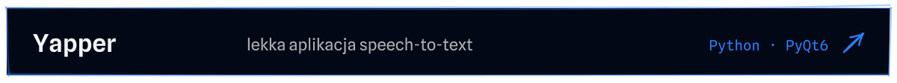
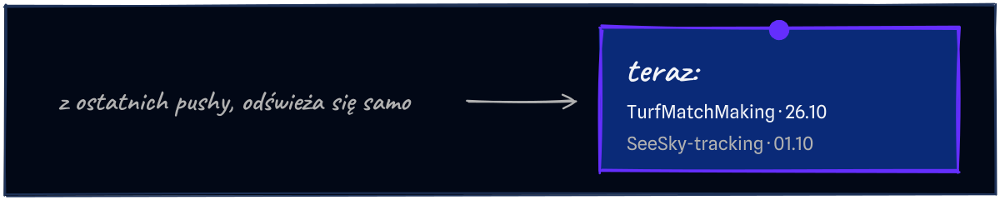

<!-- Grafiki: python scripts/build_sketch.py (karta "teraz" odświeża się codziennie w .github/workflows/update-profile.yml) -->
<a href="https://piotrjeleniewicz.com/pl/"><picture><source media="(max-width: 600px)" srcset="assets/sketch/header-pl-m.svg"></picture></a>

Buduję aplikacje i narzędzia do automatyzacji, które łączą API, dane i usługi AI. Jestem na ostatnim semestrze Elektroniki i Telekomunikacji na Politechnice Gdańskiej, a automatyzacją interesuję się od podstawówki.

**[Portfolio](https://piotrjeleniewicz.com/pl/)** · [LinkedIn](https://www.linkedin.com/in/piotr-jeleniewicz/) · [English](README.md)

<picture><source media="(max-width: 600px)" srcset="assets/sketch/divider-pl-m.svg"></picture>

<a href="https://piotrjeleniewicz.com/pl/#p-jobmanager"><picture><source media="(max-width: 600px)" srcset="assets/sketch/project-1-pl-m.svg"></picture></a>
<a href="https://github.com/Xcape53/SeeSky-tracking"><picture><source media="(max-width: 600px)" srcset="assets/sketch/project-2-pl-m.svg"></picture></a>
<a href="https://github.com/Xcape53/LabInc"><picture><source media="(max-width: 600px)" srcset="assets/sketch/project-3-pl-m.svg"></picture></a>
<a href="https://github.com/Xcape53/Yapper"><picture><source media="(max-width: 600px)" srcset="assets/sketch/project-4-pl-m.svg"></picture></a>

<a href="https://github.com/Xcape53?tab=repositories&sort=updated"><picture><source media="(max-width: 600px)" srcset="assets/sketch/now-pl-m.svg"></picture></a>

