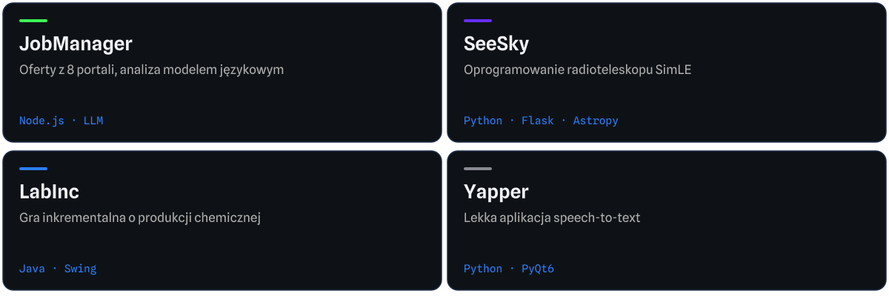
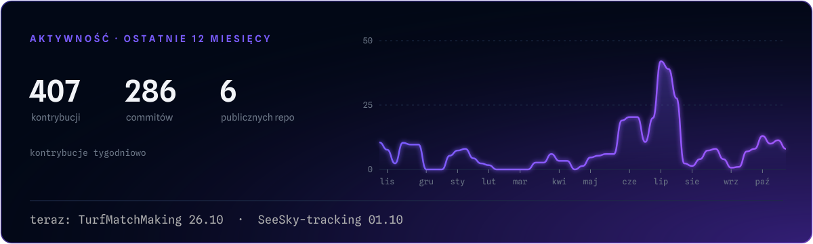

<!-- Artwork: python scripts/build_modern.py cards (activity card refreshes daily) -->
<a href="https://piotrjeleniewicz.com/pl/"><picture><source media="(max-width: 600px)" srcset="assets/modern/header-pl-m.svg"></picture></a>

Buduję aplikacje i narzędzia do automatyzacji, które łączą API, dane i usługi AI. Jestem na ostatnim semestrze Elektroniki i Telekomunikacji na Politechnice Gdańskiej, a automatyzacją interesuję się od podstawówki.

**[Portfolio](https://piotrjeleniewicz.com/pl/)** · [JobManager](https://piotrjeleniewicz.com/pl/#p-jobmanager) · [SeeSky](https://github.com/Xcape53/SeeSky-tracking) · [LabInc](https://github.com/Xcape53/LabInc) · [Yapper](https://github.com/Xcape53/Yapper) · [LinkedIn](https://www.linkedin.com/in/piotr-jeleniewicz/) · [English](README.md)

<a href="https://piotrjeleniewicz.com/pl/#projects"><picture><source media="(max-width: 600px)" srcset="assets/modern/cards-pl-m.svg"></picture></a>

<a href="https://github.com/Xcape53?tab=repositories&sort=updated"><picture><source media="(max-width: 600px)" srcset="assets/modern/stats-pl-m.svg"></picture></a>

